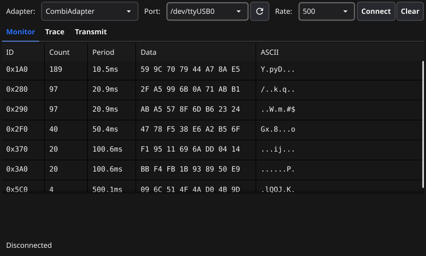
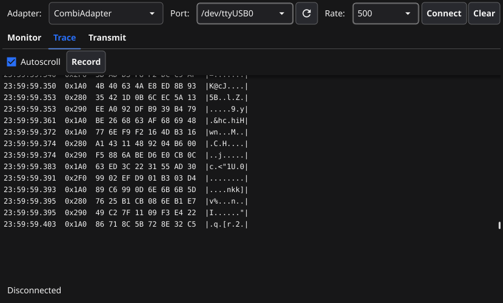
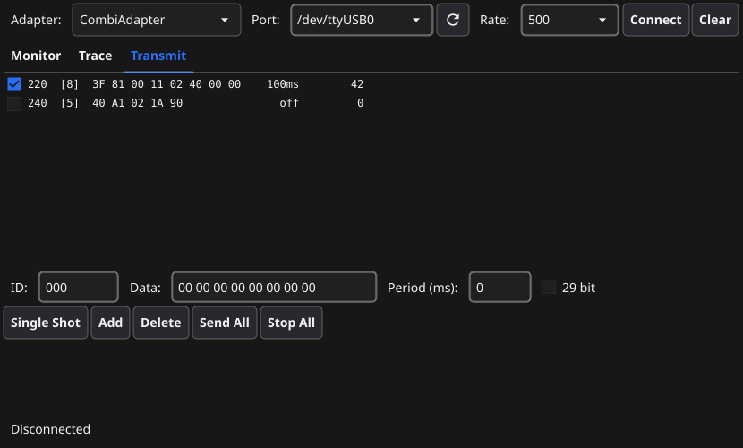

# canmonitor

A small CAN bus monitor built with [Fyne](https://fyne.io) on top of
[gocan v2](https://github.com/roffe/gocan). Connect an adapter, watch the
traffic, record it, send frames back.





## Features

- **Monitor** — one row per CAN ID with frame count, measured period (EWMA),
  last payload in hex and ASCII.
- **Trace** — chronological frame log (last 50 000 frames) with autoscroll and
  a **Record** button that writes a candump-compatible
  `CAN_<timestamp>.log` (`(epoch.micros) can0 ID#HEXDATA`) into the working
  directory.
- **Transmit** — single-shot or periodic frames, 11- or 29-bit IDs, per-message
  enable plus Send All / Stop All.
- Adapter, serial port and bitrate pickers; the refresh button rescans serial
  ports and hotplugged devices.
- Status/event log along the bottom edge.

## Build & run

```sh
go build
./canmonitor
```

CGo is required for the CombiAdapter (`adapters/combi`, libusb). The other
adapters come from `gocan/v2/adapters/all`.

Pick the adapter, set the port (e.g. `/dev/ttyUSB0`, ignored by USB adapters
that find themselves), set the rate in kbit/s (33.3 for SAAB I-bus, 47.619 for
P-bus, 500 for most modern buses) and press **Connect**.

## Screenshots

The binary can take its own screenshots — it feeds synthetic traffic through
the normal receive path, walks the tabs and writes one PNG per tab:

```sh
go build
./canmonitor -screenshot docs
```

Headless (CI, no display):

```sh
xvfb-run -a -s "-screen 0 1024x768x24" ./canmonitor -screenshot docs
```

Output is `docs/01-Monitor.png`, `docs/02-Trace.png`, `docs/03-Transmit.png`.
No adapter or hardware needed; the fake traffic uses a fixed RNG seed so the
images are reproducible apart from timestamps. See [screenshot.go](screenshot.go).

## Tests

```sh
go test ./...
```
